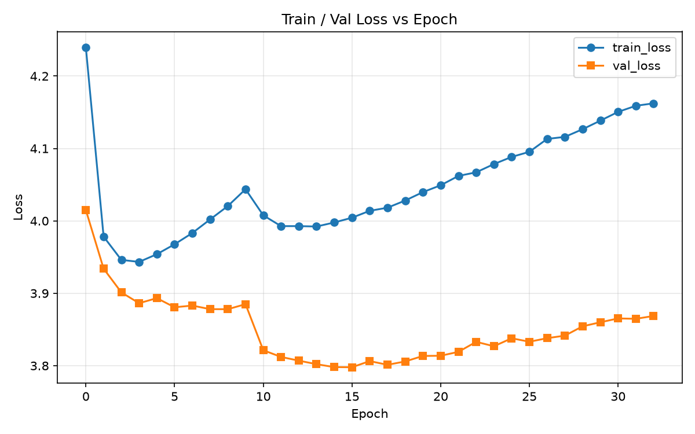
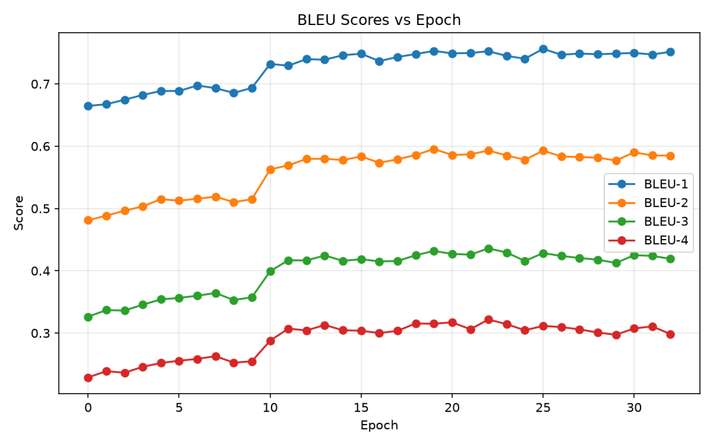

# Image Captioning with Attention

Give this project a photo and it writes a one-sentence English description of it, for example *"a man riding a wave on top of a surfboard"*. It can also show **where in the image the model was looking** as it produced each word.

The model is an encoder–decoder network in the style of *Show, Attend and Tell* (Xu et al., 2015):

- an **EfficientNet-B4** CNN turns the image into a 7 × 7 grid of feature vectors,
- **Bahdanau (additive) attention** picks which grid cells matter for the next word,
- an **LSTM decoder** generates the caption one word at a time, with **beam search** at inference.

It was trained on MS COCO 2017 (about 590,000 image–caption pairs). You can use it three ways:

| Use | Command | Needs COCO? |
| --- | --- | --- |
| Interactive web app | `python app.py` | No, only the pretrained checkpoint |
| Caption one image from the command line | `python predict.py --image photo.jpg` | No, only the pretrained checkpoint |
| Train your own model | `python train.py` | Yes |

## Contents

- [Quickstart: run the pretrained model](#quickstart-run-the-pretrained-model)
- [How it works](#how-it-works)
- [Results](#results)
- [Train your own model](#train-your-own-model)
- [Command reference](#command-reference)
- [Evaluate on the Karpathy test split](#evaluate-on-the-karpathy-test-split)
- [Project layout](#project-layout)
- [Limitations](#limitations)
- [Notes on sharing](#notes-on-sharing)

## Quickstart: run the pretrained model

You can try the model without downloading COCO or training anything. A GPU is **not** required for captioning; the CPU is fine. The commands below are for Windows PowerShell; macOS/Linux equivalents are noted where they differ.

### 1. Clone the code

```powershell
git clone https://github.com/yokeswarans/Image-Captioning-With-Attention.git
cd Image-Captioning-With-Attention
```

### 2. Install Python dependencies

Python 3.10 or later is recommended.

```powershell
py -3 -m venv .venv
.\.venv\Scripts\Activate.ps1
python -m pip install --upgrade pip
python -m pip install -r requirements.txt
```

On macOS/Linux, use `python3 -m venv .venv` and `source .venv/bin/activate` instead of the first two lines.

If PowerShell blocks activation, run the commands with `.\.venv\Scripts\python.exe` instead of `python`. For a CUDA GPU, install the PyTorch and torchvision builds that match your system using the [PyTorch installation selector](https://pytorch.org/get-started/locally/).

### 3. Download the pretrained weights

The checkpoint (about 424 MiB) is too large for GitHub, so it is hosted on Hugging Face. It must end up at `checkpoints\best_model.pth` inside the project folder.

**Option A: browser.** Open the [direct download link](https://huggingface.co/Yoki051202/Image-captioning-weights/resolve/main/best_model.pth?download=true) (or browse the [model files](https://huggingface.co/Yoki051202/Image-captioning-weights/tree/main)), create a `checkpoints` folder in the project, and save the file there as `best_model.pth`.

**Option B: command line.**

```powershell
New-Item -ItemType Directory -Force checkpoints | Out-Null
curl.exe -L "https://huggingface.co/Yoki051202/Image-captioning-weights/resolve/main/best_model.pth?download=true" -o "checkpoints\best_model.pth"
```

On macOS/Linux: `mkdir -p checkpoints && curl -L "<same URL>" -o checkpoints/best_model.pth`.

Check that the download completed (the size should be about 444,000,000 bytes):

```powershell
Get-Item checkpoints\best_model.pth | Select-Object Name, Length
```

### 4. Caption an image

**Web app**

```powershell
python app.py
```

Open the URL printed in the terminal (normally <http://127.0.0.1:7860>). Upload an image or paste an image URL, pick a beam width, and press **Generate caption**. You can also turn on:

- **Attention view:** one heatmap per generated word, showing which parts of the image the model focused on.
- **Attention video:** the same heatmaps played as a short video, one frame per word.
- **Dictionary:** search the model's vocabulary and compare two words in its learned word-embedding space.

**Command line**

```powershell
python predict.py --image test.webp
python predict.py --image test.webp --beam_size 5 --visualize
```

The caption is printed in the terminal. With `--visualize`, a caption figure and an attention map are saved as PNGs in `outputs\predictions\`. The repository includes four sample images to try: `test.webp`, `test1.webp`, `download.webp`, and `monkry.webp`.

## How it works

```text
image ─► resize 224×224 ─► EfficientNet-B4 ─► 7×7×1792 feature grid (49 regions)
                                                   │
                         ┌─────────────────────────┘
                         ▼
   for each word:  attention over the 49 regions ─► context vector
                         │
                         ▼
             LSTM cell (previous word + context) ─► next-word probabilities
                         │
                         ▼
               beam search keeps the k best partial captions
```

1. **Encoder** (`captioning/model.py`, `EncoderCNN`). An ImageNet-pretrained EfficientNet-B4 with its classifier removed. Its final feature map is pooled to a 7 × 7 grid, so each image becomes 49 vectors of 1,792 numbers, one per image region.
2. **Attention** (`BahdanauAttention`). At every step, the decoder's current state is compared with each of the 49 regions to produce 49 weights that sum to 1. The weighted average of the regions is the *context vector*: what the model is "looking at" for this word. These weights are what the attention heatmaps display.
3. **Decoder** (`DecoderWithAttention`). An LSTM cell with a 512-dimensional hidden state. Each step takes the previous word's embedding and the context vector and predicts the next word from a vocabulary of 10,307 words (every word that appears at least 5 times in the training captions). A learned gate scales the context vector so the model can rely more on language and less on the image for words like "a" or "of".
4. **Beam search** (`captioning/inference.py`). Instead of always taking the single most likely next word, it keeps the `k` most likely partial captions (the *beam width*) and returns the highest-scoring complete one. Wider beams explore more alternatives but are slower.

### Training strategy

- **Two phases.** The encoder is frozen for the first 10 epochs so that the decoder learns from stable image features. From epoch 10, the last 4 EfficientNet blocks are unfrozen and fine-tuned with a smaller learning rate (1e-4 for the encoder, 4e-4 for the decoder).
- **Loss.** Cross-entropy on the next word, plus the *doubly stochastic attention* penalty from Show, Attend and Tell, which encourages the model to attend to every image region at some point in the caption.
- **Scheduled sampling.** During training, the decoder is usually fed the true previous word (*teacher forcing*). The probability of doing so starts at 1.0 and decays by 2% per epoch, so the model gradually learns to continue from its own predictions, as it must at inference.
- **Other details.** AdamW optimizer, cosine learning-rate decay, gradient clipping at 5.0, mixed precision on CUDA, random crops and horizontal flips for augmentation, and early stopping on validation BLEU-4.

## Results

### Training run behind the released checkpoint

| Setting | Value |
| --- | --- |
| Data | COCO 2017 train: 118,287 images, 591,753 image–caption pairs |
| Hardware | 1 × NVIDIA A16 GPU |
| Batch size | 32 |
| Schedule | Up to 80 epochs, early-stopping patience 10 |
| Outcome | Stopped after epoch 32; the best checkpoint is from epoch 22 |
| Wall-clock time | About 44 hours (about 57 min per epoch while the encoder was frozen, about 89 min per epoch afterwards) |

Validation BLEU-4 rose from 0.229 after the first epoch to 0.322 at epoch 22, with a clear jump once encoder fine-tuning started at epoch 10. These per-epoch numbers use greedy decoding on a 50-batch subset of val2017 and are only meant for tracking progress; see the next section for the proper evaluation.




### Test-set scores

Measured with the official COCO caption toolkit (`pycocoevalcap`), beam width 5, on the 593 Karpathy-test images that the model never trained on (see [Evaluate on the Karpathy test split](#evaluate-on-the-karpathy-test-split) for why only 593):

| Metric | Score |
| --- | ---: |
| BLEU-1 | 0.749 |
| BLEU-2 | 0.589 |
| BLEU-3 | 0.456 |
| BLEU-4 | 0.354 |
| METEOR | 0.265 |
| ROUGE-L | 0.561 |
| CIDEr | 1.129 |

Source: `outputs/eval_karpathy_clean/karpathy_eval_clean_20260809_222556.json`. Published papers report on all 5,000 Karpathy-test images, so these numbers are **not directly comparable** with them. Read [Limitations](#limitations) before quoting them.

**What the metrics mean.** All of them compare the generated caption with the five human-written captions COCO provides for each image. BLEU-n counts matching word sequences of length up to n. METEOR also credits stems and synonyms. ROUGE-L measures the longest common word sequence. CIDEr weights words by how informative they are and is the metric captioning papers usually emphasise. Higher is better for all of them.

## Train your own model

### 1. Get the COCO 2017 dataset

Training expects this layout:

```text
data/
└── coco/
    ├── train2017/
    ├── val2017/
    └── annotations/
        ├── captions_train2017.json
        └── captions_val2017.json
```

Download and extract the official [train images](https://images.cocodataset.org/zips/train2017.zip) (about 18 GB), [validation images](https://images.cocodataset.org/zips/val2017.zip) (about 1 GB), and [annotations](https://images.cocodataset.org/annotations/annotations_trainval2017.zip):

```powershell
New-Item -ItemType Directory -Force data\coco | Out-Null
curl.exe -L https://images.cocodataset.org/zips/train2017.zip -o data\coco\train2017.zip
curl.exe -L https://images.cocodataset.org/zips/val2017.zip -o data\coco\val2017.zip
curl.exe -L https://images.cocodataset.org/annotations/annotations_trainval2017.zip -o data\coco\annotations_trainval2017.zip
Expand-Archive data\coco\train2017.zip -DestinationPath data\coco
Expand-Archive data\coco\val2017.zip -DestinationPath data\coco
Expand-Archive data\coco\annotations_trainval2017.zip -DestinationPath data\coco
```

Only the `captions_*.json` files are used; `instances_*.json` and the keypoint annotations can be ignored.

### 2. Start training

A CUDA GPU is strongly recommended. On CPU, a single epoch takes a very long time.

```powershell
python train.py --epochs 50 --batch_size 32 --patience 15 --num_workers 0
```

`--num_workers 0` is a safe starting point on Windows; raise it if data loading is the bottleneck. On the first run, the script cleans the captions, builds the vocabulary, and caches both in `data/coco/cache/`; later runs reuse the cache. ImageNet weights for EfficientNet-B4 are downloaded automatically.

At startup, the script also checks that no image appears in both the training and validation annotations and removes any overlap from validation. With the official COCO 2017 files, the two sets are already disjoint (118,287 and 5,000 images) and `runs/train.log` says so.

### 3. Monitor progress

Watch the live terminal output, or in a second terminal:

```powershell
Get-Content runs\train.log -Wait
```

`runs/STATUS` contains a one-line state (`RUNNING`, `COMPLETED`, `EARLY_STOPPED`, `STOPPED`, or `FAILED`).

On Linux or WSL, `run_train.sh` launches training inside a detached `tmux` session, so it survives a closed SSH connection. Run `./run_train.sh --status` to check on it and `./run_train.sh --stop` to stop it.

### 4. Resume an interrupted run

```powershell
python train.py --epochs 50 --patience 15 --batch_size 32 --num_workers 0 --resume
```

This continues from `checkpoints/last_model.pth`, which is saved after every epoch and every `--checkpoint_every` batches.

### What training produces

| File | Contents |
| --- | --- |
| `checkpoints/best_model.pth` | Weights with the best validation BLEU-4 so far, plus the vocabulary and config |
| `checkpoints/last_model.pth` | The most recent weights and optimizer state, used by `--resume` |
| `runs/history.json` | Per-epoch train/validation loss, BLEU-1–4, METEOR, ROUGE-L, CIDEr-D, learning rate, teacher-forcing ratio |
| `runs/train.log` | Full training log |
| `runs/STATUS`, `runs/status.json` | Current training state |
| `runs/*.png` | Loss, BLEU, other-metric, and learning-rate/teacher-forcing plots, updated every epoch |

`runs/history.json` is appended to, not overwritten. Clear the `runs/` folder before starting an unrelated fresh run.

## Command reference

### `train.py`

| Option | Default | Meaning |
| --- | --- | --- |
| `--epochs` | 50 | Maximum number of epochs |
| `--patience` | 15 | Stop after this many epochs without a better validation BLEU-4 |
| `--batch_size` | 32 | Images per batch; lower it if you run out of GPU memory |
| `--lr_decoder` / `--lr_encoder` | 4e-4 / 1e-4 | Learning rates |
| `--fine_tune_from` | 10 | Epoch at which the encoder's last blocks are unfrozen |
| `--num_workers` | 4 | Data-loading worker processes (use 0 on Windows if you hit errors) |
| `--val_batches` | 50 | Validation batches used for per-epoch metrics |
| `--log_every` | 1000 | Log every N batches |
| `--checkpoint_every` | 2000 | Save `last_model.pth` every N batches within an epoch |
| `--resume` | off | Continue from `checkpoints/last_model.pth` |
| `--device` | auto | `cuda` or `cpu` |
| `--no_amp` | off | Disable mixed precision |
| `--seed` | 42 | Random seed |

### `predict.py`

| Option | Default | Meaning |
| --- | --- | --- |
| `--image` | required | Path to the image to caption |
| `--beam_size` | 5 | Beam width (for example 3, 5, 7, 10) |
| `--visualize` | off | Save a caption figure and per-word attention map |
| `--checkpoint` | `checkpoints/best_model.pth` | Checkpoint to load |
| `--output_dir` | `outputs/predictions` | Where `--visualize` writes its PNGs |
| `--device` | auto | `cuda` or `cpu` |

### `app.py`

| Option | Default | Meaning |
| --- | --- | --- |
| `--checkpoint` | auto | Uses `best_model.pth`, falling back to `last_model.pth` |
| `--device` | auto | `cuda` or `cpu` |
| `--host` / `--port` | `127.0.0.1` / `7860` | Address the app listens on |
| `--share` | off | Create a public Gradio link; only use it if you intend to expose the app |

Attention videos are written to `outputs/predictions/videos/`; only the 5 most recent are kept.

## Evaluate on the Karpathy test split

Captioning papers report scores on the **Karpathy test split**: 5,000 COCO images set aside by Karpathy & Fei-Fei (2015). The split was defined on COCO **2014**, and its test images come from the 2014 validation set. COCO **2017** later moved most of those images into its training set, so a model trained on `train2017`, like this one, has already seen 4,407 of the 5,000 test images (88%). Scoring on them would inflate the results.

`evaluate_karpathy_clean.ipynb` handles this. It:

1. downloads the Karpathy split definition,
2. removes every test image that appears in `captions_train2017.json`,
3. captions the remaining 593 images with beam search, and
4. scores them with the official `pycocoevalcap` toolkit (PTB tokenizer, BLEU, METEOR, ROUGE-L, CIDEr).

To run it, you need the COCO 2017 annotations and `val2017` images (see [Train your own model](#train-your-own-model)), a Java runtime on `PATH` (used by the tokenizer and METEOR), and:

```powershell
python -m pip install jupyter tqdm
java -version
```

Then open the notebook in Jupyter or VS Code and run all cells from the project root. Results are saved as timestamped JSON files in `outputs/eval_karpathy_clean/`.

The older `evaluate_karpathy.ipynb` scores all 5,000 images, including the ones seen in training. It is kept only for transparency. Its results are inflated and should not be quoted.

## Project layout

```text
app.py                          Gradio web app
predict.py                      Caption a single image from the command line
train.py                        Training script
run_train.sh                    Optional Linux/WSL tmux launcher for training
requirements.txt                Python dependencies
captioning/
  config.py                     All hyperparameters and paths (Config dataclass)
  vocab.py                      Caption cleaning and the Vocabulary class
  dataset.py                    COCO dataset, image transforms, data loaders
  model.py                      Encoder, attention, and decoder
  inference.py                  Beam search and attention visualisation
  metrics.py                    Validation loss and BLEU/METEOR/ROUGE-L/CIDEr-D during training
  checkpoint.py                 Save and load checkpoints
  utils.py                      Logging, status files, metric history and plots
webui/theme.css                 Web app styling
evaluate_karpathy_clean.ipynb   Leakage-free test-set evaluation (use this one)
evaluate_karpathy.ipynb         Original evaluation including training images (do not quote)
training.ipynb                  Earlier notebook version of the whole pipeline
quick_test.ipynb                Compare predictions with ground truth on random images
*.webp                          Sample images for trying the model
runs/                           Training log, history, and plots from the released checkpoint
outputs/                        Predictions and evaluation results
checkpoints/                    Model weights (not in Git; download or train)
data/coco/                      COCO dataset and caches (not in Git)
```

## Limitations

- **Small test set.** The leakage-free evaluation uses 593 images rather than the standard 5,000, so its scores are noisier and not directly comparable with published results. A fully comparable result would need retraining on the Karpathy training split.
- **The test images are not completely independent of training.** The 593 images come from `val2017`, which `train.py` also uses to pick the best checkpoint and decide when to stop. The model never trained on them, but they did influence model selection.
- **Vocabulary.** The model can only produce the 10,307 words it saw at least 5 times in COCO captions, and it describes images in COCO's style: everyday scenes, people, animals, and vehicles. Captions for very different images (diagrams, text, art) are much less reliable.
- **Architecture age.** This is a 2015-style attention LSTM. Modern vision-language models (for example BLIP-2) produce considerably better captions.

## Notes on sharing

COCO images, annotations, generated caches, and checkpoints are excluded from Git by `.gitignore` because of their size. A fresh clone needs the pretrained checkpoint to caption images and the COCO files to train or evaluate. The COCO dataset has its own licence and terms of use, separate from this code.
